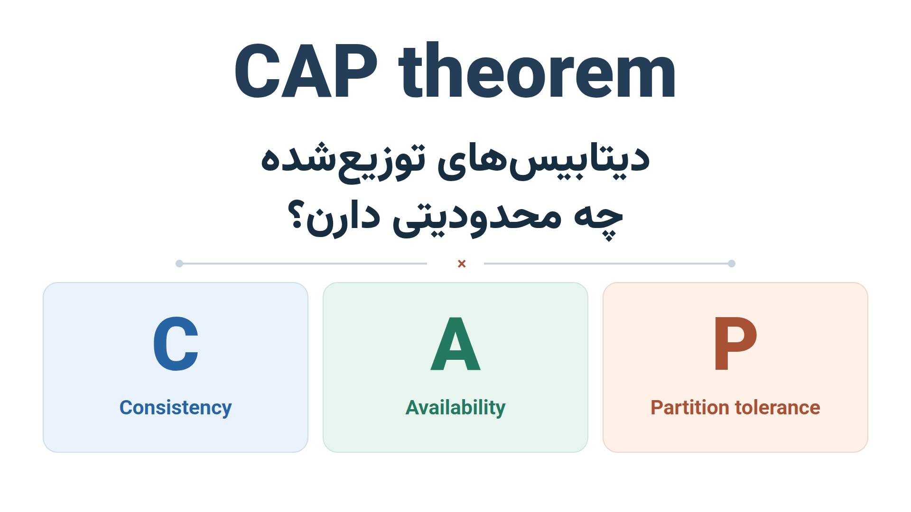

# Interactive Slides: CAP Theorem Explained Simply

[](https://youtu.be/cHsXci-57D8)
[](https://amir-kahdouii.github.io/cap-theorem-slides/)
[](index.html)

This repository contains the interactive presentation slides used in the YouTube video:  
**[CAP theorem به زبان ساده | محدودیت مهم دیتابیس‌های توزیع‌شده](https://youtu.be/cHsXci-57D8)**.

[](https://youtu.be/cHsXci-57D8)

---

## 📺 Video & Presentation Links

- **YouTube Video:** [Watch the full explanation on YouTube](https://youtu.be/cHsXci-57D8)
- **Interactive Slides (Online):** [Open Live Slides on GitHub Pages](https://amir-kahdouii.github.io/cap-theorem-slides/)
- **Offline / Local Use:** Clone the repo and open `index.html` directly in any modern browser. All fonts and runtime scripts are bundled inline.

---

## 🎯 About the Presentation

The presentation covers the fundamental constraints of distributed data storage systems defined by Eric Brewer's CAP Theorem, with a practical focus on:

- **Consistency (Linearizability):** Every read receives the most recent write or an explicit failure, behaving as if operations occurred on a single global copy.
- **Availability:** Every non-failing node returns a successful response without timing out or raising system errors.
- **Partition Tolerance:** The system functions despite arbitrary network message losses or latency delays between nodes.
- **The Partition Reality:** Because network partitions are physical inevitabilities, distributed architectures cannot pick "CA" during a partition. They must choose between preserving strict linearizability (CP) or returning locally available data (AP).

---

## 🎨 Design & Slide Features

- **Persian RTL Layout:** Crafted specifically for Persian technical content, featuring embedded **Vazirmatn** typography.
- **Minimalist Design:** Built using **VibeFarsi** design tokens on a clean paper theme with Lucide vector icons.
- **Fixed 1920×1080 Canvas:** Scaled viewport stage that prevents layout shifts across screens and projection setups.
- **OBS Presenter Cutout:** Every slide reserves a clean `320×320` square at the bottom-right corner (`x=1520, y=700`) where a webcam or OBS camera overlay can sit without covering diagrams or text.

---

## ⌨️ Keyboard Shortcuts & Controls

| Key | Action |
| --- | --- |
| `Left Arrow` / `Down Arrow` / `Space` / `PageDown` | Next slide |
| `Right Arrow` / `Up Arrow` / `PageUp` | Previous slide |
| `F` | Toggle fullscreen mode |
| `R` | Toggle recording mode (hides UI buttons and face guides while keeping camera space clear) |
| `N` | Toggle on-screen speaker notes |
| `C` | Toggle face-guide overlay for camera alignment |
| `E` | Enable live inline text editing in the browser |
| `Ctrl + S` | Download edited HTML with your in-browser text changes |
| `Home` / `End` | Jump to first / last slide |

Mouse wheel scrolling and touch swipe gestures are also supported.

---

## 🚀 GitHub Pages Deployment

An automated workflow is configured at [`.github/workflows/deploy-pages.yml`](.github/workflows/deploy-pages.yml) to automatically deploy updates to GitHub Pages on every push to `master`.

### One-Time Setup in GitHub

1. Open your repository on GitHub: `https://github.com/Amir-Kahdouii/cap-theorem-slides`.
2. Go to **Settings** > **Pages** (under the "Code and automation" sidebar menu).
3. Under **Build and deployment** > **Source**, select **GitHub Actions**.
4. Push your changes to the `master` branch. The action will run and publish the slides at:
   ```
   https://amir-kahdouii.github.io/cap-theorem-slides/
   ```

---

## 🛠️ Tech Stack & References

- **Typography:** [Vazirmatn](https://github.com/rastikerdar/vazirmatn) (embedded as Base64 WOFF2)
- **UI Components & Tokens:** [VibeFarsi](https://vibefarsi.ir) design system
- **Icons:** [Lucide](https://lucide.dev)
- **Automation:** GitHub Actions + GitHub Pages
